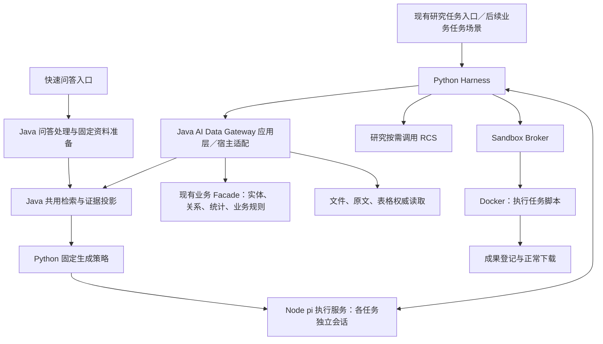

# 杰事达企业 AI 数据接入与通用业务助手建设方案

状态：方案整理稿，仅用于范围讨论和后续设计，不代表功能已经开发、业务接口已经存在或实施排期已经确定。

本文合并本次提供的“企业数据接入与通用业务助手建设”和“工具数量、动态发现及能力包治理”两份材料，并按当前分支与已确认边界修正口径。本轮只形成文档。

## 1. 统一目标与范围

建设一套共用执行底座的企业 AI 能力，让用户在权限范围内查询业务、读取资料、比较数据、计算并交付有来源的结果。项目、实验、品管、客户、生产等助手是业务能力组合，共用 Harness、pi 执行循环、证据、预算和审计机制。

本方案分为四条相互衔接的工作线：

| 工作线 | 要解决的问题 | 主要产出 |
| --- | --- | --- |
| 企业数据接入 | 有哪些实体、字段、文件、关系、版本和权限，如何按需访问 | 资源清单、Java 适配与查询接口 |
| 工具治理 | 后端大量 API 如何变成模型能正确选择的少量工具 | Registry、Discovery、能力包和任务激活策略 |
| 业务助手 | 如何利用这些能力完成具体工作 | 领域方法、只读分析、成果模板与业务评测 |
| 受控业务操作 | 如何把建议转成合法、可追踪的正式操作 | 后续独立设计的提议、确认、审批、执行与对账 |

“一套 Harness、一个主 Agent”指共用一套执行框架，每个任务有自己的主 Agent 和隔离上下文；允许多个用户、多个任务并发，也不限制后续服务多实例部署。

## 2. 对原材料的合并与修正

| 原材料中的表述 | 整理后的口径 |
| --- | --- |
| Pi＋Lagents | 使用当前 Java 宿主＋Python Harness＋Node pi，不另建一套 Agent Runtime |
| 新建工具注册中心和工具发现 | 当前已有注册、能力包、`tool_search`、`skill_read` 和动态启用基础；后续补业务接入与治理 |
| Fast QA 可以使用有限工具 | 当前模型只做固定生成；检索和允许的数据准备由宿主完成，不开放研究工具循环 |
| 统一入口、自动识别模式、复杂问题升级并继承会话 | 保留现有快速问答和研究任务两个入口、独立会话；自动路由、模式切换及会话关联暂不纳入 |
| 项目简单问答可以直接走 Fast QA | 可作为后续目标；当前简单业务查询仍需真实适配和验收，不能据此认定已支持 |
| 每个 Java API 都注册成一个工具 | 以业务意图组织工具，必要时组合多个后端只读调用；同时保留明确的业务边界 |
| 新增三个发现工具 | 优先完善现有发现入口，不直接照示例新增同义接口和重复目录 |
| 每个助手一个 Agent | 采用同一任务主 Agent 按需加载不同业务能力包 |
| 5–12 个工具是标准 | 仅作规划参考，治理要同时看 Schema 大小、选择准确率、返回体和任务效果 |
| 先全面建设数据网关，再同时建设多个助手 | 先盘点，再围绕一个真实业务闭环逐步补齐接口和工具 |

本轮也不增加有界补查、跨会话证据共享、长期记忆、新向量库、图数据库或多 Agent 调度。已有知识库问答与文献研究的真实验收缺口继续单独跟踪，不能因新方案覆盖而视为已解决。

## 3. 当前基础与待补能力

下表依据当前平台说明、工具注册与已有验收记录整理，不代替全业务代码和数据盘点。

| 层次 | 当前基础 | 后续工作 |
| --- | --- | --- |
| 通用 Harness | 调度、预算、工具账本、停止／恢复、事件、检查点、工作区和成果机制 | 面向业务任务验证工具治理及交付标准 |
| pi 执行 | 唯一模型执行循环，固定问答与动态工具两种策略 | 复用当前接口，不另建循环 |
| 检索与证据 | Java 可配置检索、版本原文、父块／相邻上下文、引用与来源校验 | 保持统一协议，补充业务记录对应的证据约定 |
| 文件计算 | 显式选输入、Docker 隔离执行、回执、成果登记和下载 | 业务数据只投影任务需要的字段和文件 |
| 工具体系 | 已有 Registry、Pack、发现、技能读取与启用基础 | 领域元数据、激活规模、版本兼容和效果治理 |
| 项目助手 | `project-readonly`：搜索、项目快照、阶段、任务列表与任务详情 | 有数据的业务闭环、正式关联资源及有界汇总 |
| 实验／数据中心 | 已有文件检索、结构化问答和实验文件相关基础 | 独立的实验查询、条件比较、按字段筛选、统计及导出能力 |
| 品管／生产／客户／物料／产品／测试中心 | 作为资源盘点对象，不因已有页面而认定 Agent 已接入 | 核实真实业务服务、数据、关系、权限和工具缺口 |

文献链路已有真实 Docker、成果下载和引用验证，但最近样本仍有导出精度、缺少 CSV、导航超标等未通过项。后续业务助手也必须分别核对工程执行、权限、证据、交付和内容质量。

## 4. 技术架构与职责

图中 Gateway 是后续业务访问能力的组织名称，首期放在现有 Java 应用层，不要求新建微服务、工程目录或集中重写现有 Facade。节点表示职责，不能据此判断所有业务工具均已实现。

| 组件 | 职责 |
| --- | --- |
| Java 业务宿主 | 当前身份、数据权限、真实业务字段、状态与版本、正式关系、业务规则和正式操作 |
| Java AI Data Gateway | 把现有业务能力投影成有界、类型明确、可追溯的 AI 内部接口；权限仍落实到实际业务服务 |
| Java 检索与读取 | 编排文档检索、融合／重排、来源投影；原文、父块、相邻节点与表格按权威接口读取 |
| Python Harness | Run、工具目录、调用校验、激活、预算、审批约束、审计、恢复和交付检查 |
| Node pi | 运行模型会话；按固定生成或 Agent 策略提出下一步动作 |
| RCS | 研究按需对授权证据评分／摘要，保持独立，不加入每次检索的必经阶段 |
| Sandbox Broker | 校验输入、管理隔离执行、资源配额、停止与执行回执 |

模型提出动作，Harness 检查执行条件，Java 最终决定业务访问和业务动作是否成立。技能说明不能授予权限或绕过程序策略。

### 两种执行策略

| 项目 | 快速问答 | Agent 任务 |
| --- | --- | --- |
| 已确认入口 | 保留当前入口与问答会话 | 保留当前研究任务入口与任务会话 |
| 资料准备 | Java 按指定范围完成所需检索与证据投影 | 模型按需调用授权的查询、检索和读取工具 |
| 模型行为 | 固定生成，不继续研究和执行工具 | 同一个主 Agent 维护任务进展并调用当前激活工具 |
| 业务助手接入 | 简单业务问题需宿主适配后另行验收 | 通过业务能力包复用既有 Agent 策略 |
| 专有交互 | 保留编辑重发等问答动作 | 保留计划、补充、排队、审批、计算和成果等动作 |

业务助手增加的是任务能力，不因此增加第三套执行框架；是否扩展现有页面名称或入口，留到产品设计阶段讨论。

## 5. 企业数据接入

### 5.1 各类资料采用适合的访问方式

| 数据 | 访问方式 | 向量索引定位 |
| --- | --- | --- |
| 项目、任务、阶段、客户、订单等结构化实体 | Java 业务查询／详情接口 | 不要求向量化 |
| 实验配方、实际条件、实测值、生产批次、质量状态 | 结构化业务读取与类型化比较 | 以业务字段为权威，不能由文档相似度替代 |
| 技术文档、论文、SOP、MSDS、COA、标准文件 | 现有文件、解析、知识库检索与原文读取 | 按知识库与授权策略索引 |
| 私有上传资料和实验文件 | 授权文件投影、解析、节点／表格读取 | 不强制发布知识库 |
| 高频跨业务统计 | 有明确口径的 Java 分析接口；必要时评估只读视图 | 不必向量化 |
| 临时文件计算和图表 | 显式最小输入文件交给隔离沙箱 | 不作为业务权威存储 |

检索到 COA 文件不能代替查询批次放行状态；找到项目报告也不能代替读取最新任务状态。文档和结构化字段可以互相补充，但要说明来源、适用版本和读取时点。

### 5.2 资源清单

先按领域填写下列信息，不把讨论材料中的示例字段或 API 名称当成现有事实。

| 盘点字段 | 内容 |
| --- | --- |
| 领域与实体 | 业务名称、正式类型、主键、业务编号及别名 |
| 权威来源 | 实际表／存储、已有 Service／Facade、可复用的公开或内部接口 |
| 字段与口径 | 字段含义、单位、状态枚举、空值、计划／实际／预测／确认状态 |
| 关联 | 正式外键、关联表、关系服务、方向及历史有效性 |
| 版本与时间 | 正式 revision／版本令牌、更新时间、读取时间与历史可读性 |
| 权限 | 组织、资源、行、字段、敏感数据、导出与文件下载范围 |
| 读取能力 | 搜索、详情、筛选、分页、聚合、关联展开及文件定位 |
| 现状与缺口 | 可复用项、待核实项、缺失接口、数据质量问题及业务负责人 |
| 验收样例 | 有授权的业务问题、真实或脱敏数据、预期事实和边界条件 |

### 5.3 统一业务结果与证据

统一结果的公共部分，保留各领域的类型化业务 DTO；不把所有对象压成一套丢失业务含义的字段。

建议公共部分包含：实体类型和 ID、所查字段、状态／版本、读取时间、来源、正式关联、分页、范围及诊断。后续接口设计需再确定具体 Schema。

还应满足：

- 来源可回到具体业务记录、字段或经过定义的业务快照；只增加一个 `provenance` 字段不等于完成引用体系。
- 复用现有 evidence／SourceRef／quote 机制；当前业务来源约定不足时补协议样例和权限规则，不冒用文献来源类型。
- 数据哈希不能代替正式业务 revision；更新时间也不能未经约定就作为可靠的并发版本令牌。
- 业务事实、程序推导、模型推断、预测和建议分开呈现；派生值保留输入来源、单位、条件与计算方法。
- 明确区分无匹配、未录入、未测试、不适用、无权限、部分结果、接口不可用和查询失败。
- 各接口只返回任务需要的字段、摘要、分页和关联句柄，不在概览里返回所有历史记录。
- 跨多次读取要说明各自时点；未获得一致性快照时，不能声称所有状态来自同一事务时刻。

## 6. 业务关系与跨模块分析

复用已有业务主键、正式关联表和关系服务。材料中的“客户→项目”“项目→实验／生产单”“生产→物料批次／检测”“产品→标准版本”均是待核实的关系清单，不能据此假定库内已经存在这些外键。

关系查询至少需要明确：关系类型、起点／终点、记录依据、版本或有效时间、当前用户可见范围、分页和结果是否完整。

禁止根据同名、客户相同、时间接近等直接建立正式业务关系。可以提示待核实线索，但不能将其作为后续范围扩展和因果结论的依据。原料晚到和项目延期同时出现，也不能单独证明原料晚到造成延期。

关联展开仅覆盖任务所需、业务关系成立且用户有权访问的对象。被隐藏对象的名称、ID 和数量不能通过关联结果或统计泄露。首次不为这些关系引入 GraphRAG 或新图数据库。

## 7. 工具注册、发现、能力包与激活

### 7.1 四个概念

| 概念 | 管理什么 | 使用原则 |
| --- | --- | --- |
| Tool Registry | 全部已批准工具及描述、Schema、处理器、权限等元数据 | 注册不等于用户可见、可调用或已经激活 |
| Tool Discovery | 在授权能力中寻找适用工具 | 沿用 `tool_search`；发现不能增加数据权限 |
| Capability Pack | 领域工具、技能、默认上下文、策略、输出和评测 | 能力包不是一个独立常驻 Agent，也不是新的权限系统 |
| Active Toolset | 当前任务实际提供给模型的工具 Schema | 根据任务按需启用；无需把整个目录常驻模型上下文 |

Java API 数量、Registry 工具数量和当前激活数量不是一回事。一个有界概览工具可以组合多个只读后端调用；不同风险、含义或授权规则的操作应分别建模。

### 7.2 工具粒度

| 类型 | 合理职责 | 边界 |
| --- | --- | --- |
| 基础工具 | 搜索业务对象、读详情、查任务或检测记录 | 参数有明确业务含义；重名时澄清，不猜 ID |
| 组合工具 | 项目概览、关联资源摘要等 | 明确字段、统计口径与展开入口，部分子查询失败必须显式返回 |
| 确定性分析工具 | 指标对比、进度统计、规则校验、批次追溯 | 查询与正式规则优先在 Java；临时文件推导可走沙箱 |
| 后续写工具 | 创建草稿、提交变更、审批执行 | 与只读工具分离，单独设计业务权限、版本、幂等及回执 |

不把全部 API 原样复制成工具，也不设置可访问任意 URL、SQL、表名或任意业务 action 的万能调用工具。

现有项目工具 `search_projects`、`get_project_snapshot`、`list_project_stages`、`list_project_tasks`、`get_task_detail` 应优先复用。是否扩展概览或新加关联接口，应看真实缺口，避免另造一套同义名称。

### 7.3 动态激活与规模治理

1. 根据入口和明确任务上下文提供必要的初始工具与能力目录，不增加自动模式路由。
2. Agent 通过已有发现机制选择所需工具，Harness 再校验能力、资源范围和执行条件。
3. 沿现有 pi worker 启用机制更新可用工具；不假定所有上游版本都能任意热注入。
4. 工具即使被猜中名称，也必须经过同样的调用、权限和参数校验。
5. 上下文压缩／恢复时保留必要工具句柄、已取得证据入口及版本约束。

“初始 5–10 个”“每包 5–12 个”仅作试点参考，不当作当前事实或全平台硬上限。先测量现有工具集合，再根据 Schema token、误选率、返回大小、失败率、模型和任务复杂度调整。

工具治理指标包括：发现成功率、正确选择率、参数错误、权限拒绝、实际调用及模型调用次数、耗时、返回体大小、重复无进展、缓存效果和交付完整性。现有文献样本的 12 次导航目标不直接套到所有业务任务。

### 7.4 能力包内容

每个领域包逐步补齐：名称与兼容版本、适用任务、已有工具、业务方法说明、上下文范围、程序策略、输出格式和评测样例。

先沿用当前 `capabilities` 与宿主适配目录，不按讨论稿一次建立八个空包、不复制多个 Runtime，也不进行新的目录重构。通用技能安装、MCP 管理和长期记忆另行评估，不与业务能力包接入混为一项建设。

## 8. 各业务助手的建设边界

以下为目标能力，不是本次开发承诺；原料／中间体／成品等实体的正式划分以实际业务盘点为准。

| 领域 | 需要核实的数据 | 首批只读交付 | 特别注意 |
| --- | --- | --- | --- |
| 项目 | 项目、阶段、任务、负责人、计划、里程碑、正式关联和文档 | 进展摘要、延期事实、风险线索、证据和信息缺口 | 风险推断不等于已证明延期原因 |
| 实验 | 记录、轮次、配方、工艺、实测结果、条件、方法与版本 | 条件可比的多轮对比、完整性检查与建议 | 计划、未测、实测、预测、确认状态分开；未测不能填零 |
| 数据中心 | 文件、表格、字段、数据记录及其业务归属 | 按字段筛选、有限聚合、对比和导出 | 明确指标和记录口径；找到文件位置不等于完成统计 |
| 品管 | 检测、适用标准、异常、复检、批次、COA 等正式记录 | 检测事实、规则对照、批次趋势和异常追溯 | 异常提示不代替放行、正式判定或 COA 签发 |
| 生产 | 生产单、计划、工序、实际进度、异常及物料／质量关联 | 进度、偏差、缺口和交付风险 | 计划数量不能冒充实际完成数量 |
| 客户 | 客户、联系人、需求、项目、订单、沟通及合同资料 | 授权业务历史、需求整理和跟进建议 | 联系人、报价、合同等需核实字段权限；不自动发送消息 |
| 物料／产品 | 正式编码、规格、版本、批次、供应商及指标 | 实体查询、批次追溯、指标与资料关联 | 名称近似不能合并批次；规格与标准需匹配适用版本 |
| 研发测试中心／标准／模板 | 样品、任务、方法、结果、标准版本、适用条件及模板 | 查询、方法核对、可比测试对照 | 不同方法、单位或条件不能未经处理直接比较 |
| 文献研究 | 已授权知识库与私有文献、原文和证据 | 研究、比较、计算、引用与文件 | 延续现有检索／证据规则，真实内容及交付缺口单独验收 |

预测和实验优化结果还需保留所用模型／数据版本、适用条件与验证状态，不能直接作为已经实测的业务事实。

## 9. 首个试点与推进顺序

采用“盘点一个业务闭环 → 复用底座并补接口 → 实际工具执行 → 核对业务与交付”的纵向顺序，不先把所有领域接口全部铺开。

建议第一个试点是：选择一个有授权数据、任务和关联实验的项目，查询当前进展、逾期任务、关联实验状态及测试缺口，生成带来源的风险清单和报告。

| 阶段 | 范围 | 交付及通过条件 |
| --- | --- | --- |
| 0. 盘点与样例准备 | 先查项目、任务、关联实验和相关文件；明确数据负责人 | 实体／字段／正式关系／权限／接口清单；可执行的业务问题和数据 |
| 1. 项目只读闭环 | 复用 `project-readonly`，按缺口补有界概览与关联查询 | 真实项目数据、准确来源、分页、重名澄清、撤权和交付验证 |
| 2. 实验与数据比较 | 按已成立关系读取实验与结构化数据，必要时计算 | 保留方法、单位和条件的比较表；原值与派生值可核对；文件可下载 |
| 3. 品管／生产／物料 | 逐个扩展具备真实数据及正式关系的领域 | 每新增领域有自己的权限、业务正确性、工具与交付评测 |
| 4. 客户及其他领域 | 按价值、数据就绪程度和权限条件排序 | 不靠新增“助手页面”替代真实业务闭环 |
| 5. 草稿及受控动作 | 另行确定业务写入和审批范围 | 提议、权限、版本、幂等、审批、正式回执及未知结果对账均具备 |

生产和品管接口若已就绪，可纳入试点补充验证；缺数据或缺正式关系时列为缺口，避免首个试点依赖所有部门同时完成。

示例执行：先解析项目指代，读取项目／任务及关联句柄；按需发现实验工具，核对实际结果与计划缺口；读取相关文档佐证，必要时对小范围数据计算；最后输出“已知事实、关联依据、风险推断、信息缺口、建议”。会议纪要转待办在只读阶段仅输出建议清单，不创建任务或通知他人。

## 10. 权限、文件与后续业务写入

### 只读阶段

用户身份、能力范围、任务资源范围和敏感字段规则共同约束访问。发现、查询、读取、缓存复用、关联展开和成果下载都要校验相应权限。统计和总数也只覆盖可见数据，不能依赖前端过滤。

已授权的读取与计算按现有策略执行，不机械增加每次查询的确认。外部检索沿既有策略；发现无权资源与资料不足应分别处理，不向模型暴露被禁止的内容。

Java 负责正式业务查询和确定性统计。沙箱只接收已授权、明确选择的最小输入，不连接生产数据库，也不隐式打包全部工作区。执行与成果继续保留选中输入、哈希、回执及正常下载核验。

### 后续写入阶段

输出建议文件、创建正式业务草稿和修改已生效业务数据是不同动作。后两者需要分别设计授权和执行规范，不能借用“外部检索已批准”的票据。

后续执行流程为：读取当前对象与正式版本 → 生成结构化变更提议及影响 → 必要的用户确认和原业务审批 → Java 再校验权限、版本与业务规则 → 调用原业务服务 → 返回正式回执。

确认只针对已展示的具体变更；参数、目标或版本变化时不能继续使用原确认。用户确认不替代质量、生产等原有审批；结果 UNKNOWN 时先对账，不盲目重放写操作。

主动巡检、外发提醒、批次放行、生产状态流转和业务数据修改均不作为首个只读试点的附带功能。

## 11. 验收与治理

| 验收维度 | 检查内容 |
| --- | --- |
| 工程 | 正确工具、参数、分页、超时、恢复、动态激活；没有第二套 Agent 循环 |
| 权限 | 跨组织／跨资源、字段权限、撤权、缓存、关系展开和导出；工具名猜测不能绕过 |
| 数据 | 状态、单位、方法、版本、统计范围、空值与预测标识均符合业务口径 |
| 证据 | 每项关键事实可回到具体授权记录／原文；哈希和引用有效不等于结论正确 |
| 交付 | 用户要求的报告、JSON／CSV 等逐一核对；经过正常登记和下载检查 |
| 内容 | 事实和推断分开，相关性不冒充因果，未测不判失败，异常不等于放行结论 |
| 效率 | 与同任务基线比较检索、模型、工具、耗时、重复和返回量；不以工具少或结构统一自证提效 |

真实／脱敏业务数据验收与合成边界测试分开。空库、模拟记录、单元测试和任务状态都不能单独代表业务闭环完成。无足够真实数据时先完成工程测试，并明确业务验收尚缺的条件。

多 Agent 仅在单主 Agent 经测量出现独立并行任务、上下文或专业隔离需求时再评估；领域多、接口多本身不构成引入理由。

## 12. 后续待确认项和设计产出

本轮不要求立即回答，也不将下列事项默认为已确定：首个试点项目和数据环境、业务负责人、正式关联是否完整、业务状态／指标口径、敏感字段与导出边界、验收人及后续写入审批责任。

后续按试点逐步形成以下产出，不一次创建大量空接口或空能力包：

1. 企业 AI 数据资源清单：当前实体、真实字段、正式关系、现有 Facade、权限和缺口。
2. Java AI 访问与业务证据规范：类型化请求／结果、范围、分页、来源、版本与诊断。
3. 工具注册与发现治理规范：复用现有入口，补充分类、参数约束、版本、预算与可观测指标。
4. 业务能力包规范：工具、领域方法、上下文、程序策略、模板及评测组织。
5. 首个试点实施与验收清单：具体问题、数据、工具、预期交付、失败条件和记录方式。
6. 进入写阶段时再形成业务动作与审批规范；不在只读方案中隐式开放。

### 当前实现依据

- [Agent 平台说明](../../jsd-aird-agent/README.md)
- [现有能力包与项目工具注册](../../jsd-aird-agent/control/src/aird_agent/capabilities/registry.py)
- [现有工具定义](../../jsd-aird-agent/control/src/aird_agent/capabilities/definitions.py)
- [统一检索与父块回取](../../jsd-aird-agent/docs/retrieval-pipeline.md)

当前业务细节以之后的实际模块盘点为准；本文件的能力清单和示例不构成已实现状态说明。
