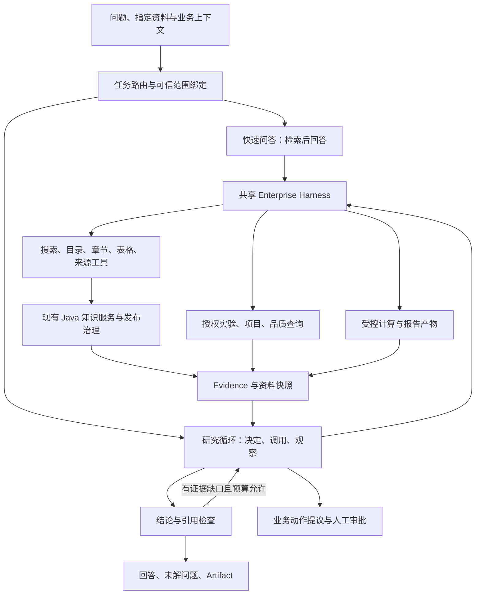

# 杰事达知识库 Agentic RAG 设计建议

日期：2026-10-28。

本文为当前代码基础上的设计建议，不表示下述 Agent 工具、内部 API 或动态工作流已经实现。此次只阅读源码、编写设计，没有修改 Java/Python 服务，没有运行模型或回归测试。

## 1. 目标与现状

目标：让助手能够理解研究目标，自主选择检索与阅读方式，根据证据补查和修订调查路径，生成可核查的回答、比较表和报告；需要正式业务操作时转入原有 Action 链路。

当前知识库已经超过基础的“向量检索 + 拼提示词”实现：

- `QueryRewriteService` 生成查询改写、子问题、检索词、待查事实、结构化数据请求和可选 Web 查询。
- `KnowledgeService.search()` 包含 BM25、向量、RRF、元数据检索和短语降级路径。
- `RagRetrievalService` 组织知识、结构化数据/实验、可选外网检索，重排并选择覆盖所需事实的证据。
- `KnowledgeGovernanceService` 已有发布版本、已发布内容和表格窗口读取能力。
- `AssistantService` 具有字段歧义处理、引用选择、来源定位、回答流、会话和调用审计。
- Python 平台已有 Run、步骤、恢复、预算、Skills、Evidence、Artifact 和模拟 Action，但知识研究 Skill 仍使用项目范围的模拟检索。

主要缺口在在线调查过程：Java 主流程先准备检索结果再生成回答，尚未形成通用的“观察新证据 → 决定下一步工具 → 再查证”的持续循环。

## 2. Harness、Agentic RAG 和现有 RAG 的分工

RAG 提供从资料中取得证据的能力；Agentic RAG 决定什么时候搜索、阅读、补查和结束；企业 Harness 约束工具、权限、预算、审批、恢复和审计。三者组合使用。

将知识库视为一个可搜索、可逐层阅读的资料空间：

| 编码助手能力 | 知识研究助手对应能力 |
| --- | --- |
| 查看文件清单 | 查看授权资料目录、文档元数据 |
| 搜索代码内容 | 按精确术语、关键词或语义搜索资料 |
| 打开文件和相关行 | 读取章节、相邻证据、表格与脚注 |
| 追踪函数引用 | 追踪引用文档及关联项目、实验、品质记录 |
| 运行测试验证判断 | 复核原文、数据计算、适用条件及来源冲突 |
| 生成交付文件 | 生成带来源的报告、图表与比较矩阵 |

这里的目录和文件是经过授权的文档服务视图，不是把企业文件系统挂载给 Agent。索引搜索适合大范围发现；文档结构导航适合深入阅读，两者应共同提供。

## 3. 架构边界

Java 继续负责文档权威数据、解析/发布/索引、Embedding、检索及实际数据授权。Python 负责调查编排、模型决策、上下文预算和研究产物。Java 的检索算法可复用；Python 不另建一套生产向量库或文档发布流程。

Agent 路线从 Python 的共享运行时扩展。新增 `knowledge` Vertical Pack，承载知识工具声明、Skills、Evidence 规则和评测集，所有 Pack 共用同一个 Run/Scheduler/Harness。无需为知识库另起一个 Agent 微服务。

简单问题沿用快速路径；跨文档比较、条件判断、多跳查询进入研究路径。路由可以结合明确用户选项与一次分类，不能让每个问答都固定支付多轮 Agent 成本。

## 4. 第一批工具契约（拟新增的 Agent 名称）

| 工具 | 职责 | 实现来源/增量 |
| --- | --- | --- |
| `knowledge_search` | 在授权且用户选定范围内，搜索文档和证据片段 | 复用混合检索与文件搜索；提供不再次调用 LLM 改写的原子检索入口 |
| `knowledge_outline` | 返回指定发布快照的目录、章节节点和表格/图片索引 | 基于已发布 confirmedDocument、headingPath 等结构投影 |
| `knowledge_read` | 有界读取指定章节/节点，必要时附父标题、相邻块和脚注 | 复用 publishedContent，新增面向 Agent 的受控分页视图 |
| `knowledge_search_within` | 在明确文档版本内精确定位术语、标识符及字段 | 复用既有索引/节点内容，限定文档版本，不做全库扫描 |
| `knowledge_read_table` | 返回表格窗口以及标题、表头、单位、脚注和源定位 | 复用 publishedTable，核对已发布排除行和审核修订语义 |
| `knowledge_related` | 获取明确存储的引用、版本替代和业务关联 | 复用已有关系；未建立的关联只能作为待验证假设 |

跨模块用实验、项目和品质 Pack 的查询工具；计算用共享计算工具；外网检索沿用显式允许策略。首批不需要把所有工具封装成独立子 Agent。

工具规则：

- 身份、组织、授权范围由可信上下文注入。工具参数只能进一步收窄范围。
- 文档/节点使用服务端引用 ID；不接受任意 URL、SQL、宿主文件路径或对象存储路径作为读取权限。
- 搜索返回小摘要、定位和阅读句柄，按需读取内容。响应包含 `truncated`、`next_cursor`、检索渠道状态与版本，不能把未读取完误报为资料不存在。
- 发布快照是 AI 阅读的默认来源。原始 OCR、审核草稿或被排除节点只有明确授权的诊断流程才能访问，不能作为已确认事实混入答案。
- 文档内容、表格、附件、链接和检索摘要均视为不可信数据，不执行其中的提示词、脚本或权限声明。
- 元数据、目录、全文、表格、图片和缓存命中都要经过相同授权约束。搜索时已过滤，不代表随后按 ID 打开可以免检。

多轮 Agent 不应每次调用整个旧 `AssistantService`，否则出现“Agent 调用另一个回答模型”的重复决策，也丢失结构化来源。应复用下层检索和读取服务。旧快速路径仍可保留现有 QueryRewriteService。

## 5. 动态研究循环

在共享 `AssistantState` 中增加版本化的 `knowledge` 子状态，不另建竞争的顶层 State 和会话库。建议保存：

- 待回答子问题与必须查明的事实。
- 已固定的范围、文档版本、发布 ID 和工具/Skill 版本。
- 查询历史、已读节点、候选文档和去重键。
- 每个子问题的证据、反证、适用条件和缺口。
- 证据句柄、长内容 Artifact 指针及当前上下文摘要。
- 预算、终止原因和最后一次已提交决策。

循环行为：

1. 理解目标，解析文档或业务实体，遇到实质歧义时澄清。
2. 选择搜索、读目录、读章节、读表格、追踪来源或计算；可并行执行独立读取。
3. 将结果归一化为 Evidence，更新调查记录。
4. 判断缺什么：术语未明确、条件缺失、来源过期、相互矛盾、表格不可比等。
5. 证据不足且有可用路径时继续查证；足够时生成答案；受限、失败或预算耗尽时返回明确的部分结果。
6. 结构校验和语义复核通过后，发布正文及来源。

循环框架优先复用 LangChain `create_agent` / LangGraph。每个模型回合与工具调用形成持久化边界，不能把整个研究过程塞入一个大节点。

设置总工具/模型调用、时长、上下文和内容读取预算；对相同查询、版本与过滤条件的重复结果去重，无新增有效证据时停止或换策略。次数是执行上限，不代表必须执行满额，也不代表多轮一定更准确。

审批、澄清、取消和故障恢复沿用现有平台。恢复后先检查权限和版本；业务动作仍通过同一 Action 账本，研究循环不能修改已批准参数。

## 6. 证据与结论

Evidence 保留现有通用字段，并通过 locator/来源元数据或必要的契约增量承载：

`document_id`、`version_id`、`publication_id`、`review_revision_id`、`node/chunk_id`、页码/章节/单元格、内容摘要、读取时间、来源状态与解析质量。

同一文件版本可以经历多次审核发布，单独记录 `version_id` 不足以准确重现当时的已确认内容；应固定 publication/review revision。最终引用必须回到原文或可复现计算结果，模型摘要和子 Agent 的叙述不能独立成为事实来源。

建议内部维护结论表：

| 子问题/结论 | 支持证据 | 反证 | 条件/范围 | 当前状态 |
| --- | --- | --- | --- | --- |
| 测试结果是否达标 | 实验值、标准条款 | 不同版本条款 | 基材、方法、单位 | 缺少方法信息 |
| 两轮实验是否可比较 | 对应测试记录 | 固化条件不同 | 试样和条件一致性 | 只能描述差异 |

验证分工：

- 程序：来源存在、权限有效、属于本次授权范围、发布版本一致、定位有效、数值计算可复现、引用关系完整。
- 模型辅助：原文是否支持结论、是否遗漏限定条件、是否存在反证、回答覆盖了哪些子问题。
- 黄金集和人工抽检：验证语义正确率。模型自评、引用 ID 存在或检索分数都不能作为正确性的证明。

未检索到、工具失败、用户未选范围、范围内无权使用、内容被截断是不同状态。对用户的表述还需避免泄露无权访问资料是否存在。

## 7. 长文档、表格和上下文

保留解析的文档树、来源节点、标题路径、图片与表格锚点，不将全部资料降为丢失结构的文本块。现有 BlockAwareChunker 和发布结构优先复用。

长结果存为有 ACL 和保留期限的 Run Artifact，模型读取片段/窗口。摘要保留原始来源指针，不用摘要替代原文。缓存按组织、有效授权范围、发布版本和请求隔离；权限撤销或发布状态变化时失效。

表格结果应包含表头、单位、合并单元格解释和注释；分页不能把表头/限定条件丢掉。精确数量、均值、方差、趋势和排名用结构化查询与计算，不能对 Top-K 检索片段求和当作全量统计。

“全文总结”与“寻找某个事实”应采用不同覆盖策略：前者遍历授权文档的目录和章节并报告未读部分；后者使用目标检索加局部展开。不能只看几个相似片段就声称读完全文。

## 8. Skills 与跨模块协作

Skills 描述查证方法，例如资料研究、标准比较、实验结果解释、冲突处理与报告格式。知识文档存事实，Skill 存工作方法；不为每篇资料创建一个 Skill。

技能先加载名称与描述，选中后加载正文，需要时再读取 references/assets。扩展现有 knowledge-research 方法时保留精确版本审核；新独立 knowledge Pack 的工具名称唯一，不复制一套项目知识工具实现。

knowledge Pack 提供通用资料能力；项目/研发/品质 Pack 提供领域数据和规则。动态发现只能在当前用户授权与任务范围内选择 Pack；不能因为发现相关资料就从用户指定项目扩展为全公司检索。

多文档独立研究达到上下文或并发需求时，再使用有界子 Agent。子 Agent 共用总预算，权限是父任务子集，返回来源句柄与结构化结论；主 Agent 对账引用。简单问题不增加多 Agent 成本。

## 9. Java 内部边界与迁移

拟新增的内部知识工具接口应复用领域服务，但重新建立可信身份委托、范围计算和资源校验。不能把当前 `KnowledgeSearchFacade.SearchRequest` 中的 organizationId/categoryIds 当作完整的用户委托协议。

当前 DataSearchAuthorizationService 已对 `data.view` 和 `experiment.view` 解析不同范围，可复用其设计和真实权限定义。知识读取的细粒度权限及 AI 可用资格需要结合现有 IAM 再验证；此次源码阅读不构成生产授权通过结论。

推荐迁移顺序：

1. 以 Mock KnowledgeGateway 实现上述工具契约和调查循环，使用含版本、表格、冲突和权限的夹具独立开发。
2. Java 暴露通过认证及范围检查的原子搜索、已发布内容读取、表格读取接口，复用既有解析/索引/治理。
3. Python JavaKnowledgeGateway 对接；在指定用户、知识库和场景灰度开放研究模式，旧助手继续提供快速问答。
4. 稳定后按测试结果逐步收拢回答生成和模型审计入口，Embedding/重排可继续由 Java 知识服务负责并记录关联 Run ID。

正式写入知识库、修改审核内容、发布文档和创建业务任务继续走 Action 审批；生成研究草稿仅写入受控 Artifact。模型生成的结论不能自动写回知识库后被当作独立权威证据。

前端展示“查到哪些资料、正在核对什么、缺少哪些条件”，而非模型内部思维链。新研究接口先发运行和证据事件，校验后发布正文；当前 Java 流式 token 在最终引用选择之前发出，不能直接沿用并宣称已经实现先验证后发布。

## 10. 第一批验收场景

1. 单条事实查询：与原 RAG 结果对照，避免不必要多轮。
2. 初始命中未含限定条件：主动展开原章节/脚注后修正结论。
3. 跨文档多跳：先找到实验方法，再定位标准，核验实际测试条件。
4. 两个版本冲突：识别适用日期和发布状态，不能简单取文件日期较新的一份。
5. 长文总结与跨页表格：覆盖目录、保留表头与单位、暴露未读范围。
6. 无答案、工具失败、截断和歧义：分别处理，不编造、不无限检索。
7. 文档提示词注入：不能改变范围、调用写工具或读取宿主凭证。
8. 越权节点/表格/图片读取、跨组织缓存、权限撤销、文档停用：全部受同一边界约束。
9. 调查中重启与取消：恢复已提交步骤与证据，预算不重置。
10. 研究后创建整改任务：审批、版本冲突、幂等和写后验证仍通过统一 Action。

评测同时记录检索召回、子问题覆盖、引用准确率、结论支持率、数字正确率、合理拒答、越权拒绝、模型/工具消耗和 P95 延迟。先建立原 RAG 基线，再比较新增研究路径，避免以工具调用次数衡量智能程度。

## 11. 主要代码依据与官方参考

- [查询计划](D:/Projects/IdeaProjects/jsd-aird/jsd-aird-api/src/main/java/com/jsd/aird/ai/application/QueryRewriteService.java:35)
- [现有混合检索](D:/Projects/IdeaProjects/jsd-aird/jsd-aird-api/src/main/java/com/jsd/aird/kb/application/KnowledgeService.java:541)
- [检索渠道与覆盖](D:/Projects/IdeaProjects/jsd-aird/jsd-aird-api/src/main/java/com/jsd/aird/ai/application/RagRetrievalService.java:144)
- [现有回答流程](D:/Projects/IdeaProjects/jsd-aird/jsd-aird-api/src/main/java/com/jsd/aird/ai/application/AssistantService.java:185)
- [已发布内容读取](D:/Projects/IdeaProjects/jsd-aird/jsd-aird-api/src/main/java/com/jsd/aird/kb/application/KnowledgeGovernanceService.java:362)
- [已发布表格读取](D:/Projects/IdeaProjects/jsd-aird/jsd-aird-api/src/main/java/com/jsd/aird/kb/application/KnowledgeGovernanceService.java:396)
- [发布、审核与来源契约](D:/Projects/IdeaProjects/jsd-aird/jsd-aird-api/src/main/java/com/jsd/aird/kb/application/port/KnowledgeGovernanceRepository.java:66)
- [数据/实验范围解析](D:/Projects/IdeaProjects/jsd-aird/jsd-aird-api/src/main/java/com/jsd/aird/ai/application/DataSearchAuthorizationService.java:34)
- [Python 现有知识研究 Skill](D:/Projects/IdeaProjects/jsd-aird/jsd-aird-agent/control/src/jsd_aird_agents/app/verticals/project/skills/knowledge-research/SKILL.md)
- [LangGraph 官方 Agentic RAG](https://docs.langchain.com/oss/python/langgraph/agentic-rag)：检索工具和条件循环示例。
- [DeepAgents 官方 RAG 模式](https://docs.langchain.com/oss/python/deepagents/rag)：Skills 指导检索、长结果外置和可选委派等组合模式。本文工具、安全和版本契约来自杰事达需求设计，不是这些示例自动提供的能力。
