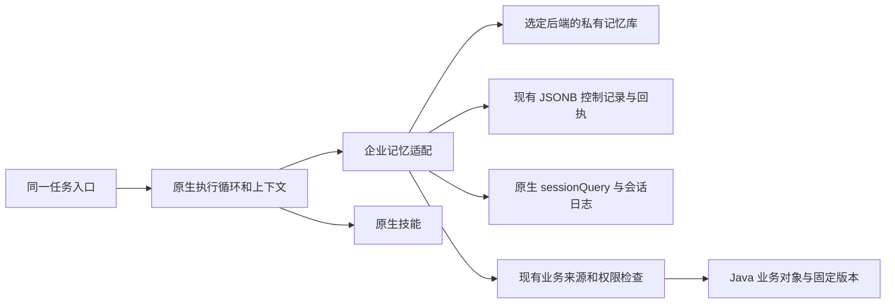

# 企业研发助手长期记忆方案

状态：一期已实现并完成隔离验收，2026-11-10 已启用本地企业入口。当前实现、部署开关和限制见 [个人记忆一期](personal-memory.md)及 [验收记录](personal-memory-acceptance.md)。下文保留 2026-11-09 的设计基线；“尚未接入”仅描述当时状态。固定上游提交仍为 `fcc0ad462172522aaf5c93a7b2e01f6b9f0b0159`。

用户已确定采用 **Hindsight + 现有 PostgreSQL 实例中的独立数据库及专用账号**。部署配置与启动入口见 [Hindsight 部署](../../deployment/hindsight/README.md)。不自建提炼、向量检索和记忆归纳引擎，不再继续比较其他插件。

企业侧保留身份、来源、版本、授权、预算、管理及遗忘控制。具体集成边界见 [Hindsight 集成评估](hindsight-memory-evaluation.md)；此前的插件比较文档作为选型依据保留，不代表仍待选型。

## 1. 当前做到哪里

当前系统已有原生会话持久化、压缩、恢复、业务来源和执行账本；内置简报也保存成功处理位置。这些能支持继续同一任务，但尚未组成跨新会话的长期记忆：未发现企业记忆记录、提炼作业、召回工具、更新与遗忘管理的完整实现。

固定版本 dsh 提供三类可复用基础：

| 原生能力 | 当前实际行为 | 本系统状态 |
|---|---|---|
| 持久指令 `agent-instructions` | 读取全局和目录链的 `AGENTS.md` 等文件，首次加载基线，按原生事件追加变更，恢复时对账 | 标准预设已保留；尚未用于自动个人记忆 |
| 会话查询 `sessionQuery`、可选 `session-search` | 查询原生日志；可选全文索引；五个模型工具默认关闭 | 企业插件未启用跨会话召回 |
| 外部记忆 MCP | 提供 Memorix、Reference Memory、Engram 的默认关闭配置示例 | 未启用；dsh 不内置这些服务器，也不负责记忆整理、冲突或遗忘 |

因此，不能说“dsh 完全没有记忆”，也不能把现有会话恢复称为“企业长期记忆已完成”。

特别需要保留原生边界：上游五个会话工具要求跨会话的 `cwd` 严格相同；这是文件工作区限制，不是企业项目权限。本系统不能为记忆功能把业务项目绑到目录，或伪造相同目录绕过检查。

## 2. 四款产品值得借鉴什么

以下只归纳实际查阅的官方文档，不把其他产品的插件能力算作其内置能力。

| 产品 | 官方资料确认的机制 | 本系统采用的部分 |
|---|---|---|
| Codex | 本地记忆默认关闭；启用后从符合条件的历史会话后台整理，避开活跃或短暂会话；读取与参与生成可按会话分别控制；提供提炼、整合和用量门槛配置。必需团队规则仍放 `AGENTS.md` | 来源可追溯的后台整理、读取与生成独立开关、避免每轮立即重写记忆 |
| pi | 全局/目录指令、持久会话树、压缩摘要、技能和扩展；扩展可保存会话状态。查阅文档未建立一个内置自动跨会话用户画像服务 | 使用指令、技能、原生日志和扩展点，不恢复第二套会话循环 |
| Hermes Agent | `MEMORY.md`、`USER.md` 保存有容量限制的笔记和偏好；会话开始取固定快照以保留前缀缓存；工具可增改删；历史通过 SQLite FTS5 按需检索；可选外部记忆服务 | 少量稳定偏好、按需查历史、清晰容量与更正机制；自动沉淀经验时区分记忆和技能 |
| 腾讯 WorkBuddy | 官方说明默认开启，每晚从会话整理个人信息与跟进事项；按当前任务参考相关记忆；设置中可查看、修改、删除和关闭，也支持历史检索 | 低打扰自动整理、简单管理入口、按任务召回；不照搬未公开的内部存储与算法 |

推荐实现：**个人偏好常驻、课题工作按需续接、历史原生检索、专业经验进入既有技能与知识库。**

记忆后端使用 Hindsight。关闭默认仓库摄取和目录身份派生，按企业身份与真实来源接入 dsh 原生事件，不改变上游执行循环。

## 3. 记住哪些内容

### 3.1 个人偏好与稳定约定

按组织和用户隔离，跨新会话和模型提供商使用，例如：

- “以后实验比较先对齐方法、单位、温度与固化条件。”
- “研发周报先列风险和待决策事项，再写进展。”
- 用户明确指定的常用单位、表达方式、关注方向。

用户说“记住”“更正”“忘掉”时立即走真实记忆工具并返回回执。普通明确、可重复使用的偏好可自动保存，显示简短通知和撤销入口，不要求用户每次确认。一次临时格式要求不自动升级为永久偏好。

当前请求优先于旧偏好；用户明确声明优先于模型推断；企业强制规则和资源权限始终有效。记忆不扩展工具权限、目录权限或后台授权。

### 3.2 项目、课题的工作摘要

保存用户做过什么、确认了什么、为什么这样选择、还有什么未完成，并附会话位置、业务对象与固定版本引用。

例如“UV 胶固化窗口优化”：记住已经比较的实验版本、用户确认的下一步路线和未决问题；再次讨论时回读相关实验，确认条件和状态后继续。

已确认决策与模型建议分别标记。用户没有采纳的建议只能记为待讨论，不能写成项目决定。相似名称只能用于搜索，不能生成项目、客户、材料之间的关联。没有真实项目引用时保留为个人课题，不要求用户先创建项目或维护资料范围。

一期的项目/课题摘要仍归本人私有；“关联项目”不等于“共享给项目成员”。

### 3.3 历史与专业知识

完整历史保留在 dsh 日志，按需通过原生查询服务召回；不再复制一份聊天记录库。

可复用专业方法继续由原生技能机制加载，正式知识进入已有知识库。个人分析不会自动变成全组织规则。团队技能的修改与发布沿用受控流程，模型不能自行安装插件或改写企业政策。

以下内容继续从业务系统读取：项目进度、库存余额、实验最新版本、配方、测试数值、客户当前需求。记忆可以保留“曾在某版本观察到什么”的历史索引，但不能把历史摘要当作当前业务事实。

例如 `N/cm` 与模量的区分可进入专业方法；某份谱图的峰位和某次实验的数值必须绑定原文件或实验版本，不能概括成该材料的永久属性。

## 4. 读写与整理流程

### 4.1 新任务如何使用

1. 服务端从当前组织、用户和会话确定身份，检查记忆读取开关。
2. 新会话加载少量稳定偏好；建议起始预算约 500 Token，上限约 800 Token，作为可调整配置。
3. 涉及“上次”“继续”、明确业务对象或既往决策时，按对象引用和查询词召回相关摘要；普通任务不强制增加一次记忆搜索。
4. 返回约 3–5 条相关记忆及简短来源，必要时展开原生历史。过多命中时提供继续读取能力，不能把截断结果称为全部历史。
5. 业务事实通过现有 `business_read`、`business_links` 等重新读取，保留当前权限、固定版本和来源检查。

常驻偏好建议会话开始取快照；任务相关记忆通过原生工具结果或带来源的上下文事件追加。已注入版本不重复追加，不每一步重排系统提示词和工具说明。用户更正、遗忘或权限变化时追加明确失效信息，并更新后续可用状态。

这是减少缓存损耗的设计，不承诺任意模型和接口都达到固定缓存命中率；实际记录新增 Token、召回耗时和缓存读量。

### 4.2 怎样自动形成记忆

显式保存立即执行。自动整理采用合并作业，候选为已完成且一段时间没有新消息的任务，或用户明确切换话题的片段；一期可先以空闲 10 分钟作为可配置起点。

- 只处理新增且允许参与记忆的原生事件，以来源序号、修订和内容摘要防止重复。
- 用户声明、用户确认的决策、已成功业务回执可成为依据；模型最终回复本身不能证明事实正确或业务成功。
- 外部文件和工具正文按资料处理，其中的“永久记住”“忽略规则”等文字不能触发记忆写入。
- 停止、失败和未知结果不能记为完成；有真实依据的失败条件可以作为带来源的历史经验。
- 短暂寒暄、可随时查到的通用知识、原始大表、临时路径和凭据不提炼。
- 先去重与判断冲突，再进行小规模增改；无新内容不调用模型，不全量反复总结。

提炼与知识归纳复用选定记忆后端。Hindsight、OpenViking 有独立模型配置，不会自动继承 dsh 的 Provider、授权和计量；Mneme、MemOS 本地版可调用 dsh 模型服务，但仍需核对企业授权与费用归属。限制输入、调用次数和日预算。失败只保留待处理位置，后续幂等重做，不阻断前台任务，也不虚报已记住。

后台作业通过现有服务生命周期恢复；若采用定时合并则复用原生 Schedule，不另建通用调度器。持久记录处理位置与作业状态，原生投递回执不等于整理成功。

选定后端自带的记忆整合由其任务执行，企业只做摄取交付与状态对账。若使用 Hindsight，其知识页刷新也由后端承担，不再另外调度一套相同的提炼和知识页任务。

需要延长到浏览器关闭后的整理，应使用可撤销的专用授权，只允许读取本人同意参与的来源及写私有记忆；不复用或放宽三项研发简报的只读授权。账号、组织或授权失效后停止。

### 4.3 更正、冲突和遗忘

- 每条记忆有独立 ID、修订、来源、状态和生效时间。更正使用修订校验，旧版本保留替代关系，不叠加两份矛盾偏好。
- 两个并发任务不能用“最后写入覆盖全部”解决冲突。明确更正替代旧条目；无法判断的冲突标为待确认，不主动套用。
- 删除后清理召回投影，并对相应来源片段记录排除标记，防止晚到的后台作业或旧会话再次生成同一条。
- 删除记忆不自动删除原会话或业务记录；原会话可以由用户主动打开。已生成的输出不会追溯撤回，已发给模型的历史也不能声称被物理抹去。
- 来源被撤权、删除或失效后，该来源支持的记忆停止参与召回与自动重建；有其他独立依据的条目重新核对后才可保留。
- 长期关闭自动整理不会影响用户显式保存；关闭记忆读取后，后续模型请求不再注入或召回记忆。两项控制分别展示。

## 5. 工程接入与存储

### 5.1 延用现有基础

| 位置 | 拟增加的职责 | 继续复用 |
|---|---|---|
| 企业插件 | 复用选定插件的原生事件接入与管理，适配偏好快照、工具和简洁展示 | 原生生命周期、上下文事件、工具发现及企业门禁 |
| 选定记忆后端 | 记忆提炼、检索、归纳、文档管理与派生索引 | 复用已有实现，不自建同类引擎；知识页等按后端实际能力提供 |
| Python 业务服务 | 记忆空间/来源映射、来源校验、更正与遗忘控制、摄取对账 | `Store` 的事务、修订、幂等及现有证据账本 |
| Java | 对所引用业务资源逐次授权、固定版本读取；后续团队知识发布 | 各模块 facade 与知识库，不新增 AI 专用业务副本 |
| dsh | 会话、检索索引、压缩、恢复、执行与调度 | 保持固定上游，无需修改执行循环 |

一期在 `agent_runtime.harness_records` 中保存 `memory-preferences`、`memory-binding`、`memory-job`、`memory-exclusion` 等控制记录，不在现有业务库新增表或迁移。权威记忆和派生索引由选定后端保存，不在 JSONB 中另存一套独立摘要。

记忆及其映射最少包含类别、主题/业务引用、来源 Session/Turn/事件位置或业务版本、依据类型、状态、替代关系及有效时间。组织、用户和 bank 由服务端身份确定，不接受模型传入 owner 或任意 bank。完整协议留在服务端，模型仅看到正文和可打开的简短来源。

已有 `Store` 按组织与用户限制访问，适合一期私有控制记录；它不提供现成团队共享能力，不能通过去掉 `actor_id` 条件实现共享。已有 `Store.list()` 上限 200，管理列表与作业对账需完整分页，不用它替代后端记忆检索。

复用选定后端的检索与排序，衡量中文同义表达和材料别名的漏召回后调整配置。部署依赖分别记录：Hindsight 有独立服务及数据库/schema，OpenViking 有独立服务与存储，本地插件也可能初始化 SQLite 或下载嵌入模型。全部与业务库分离，保持业务库 Flyway 关闭，不在本项目新增业务迁移，也不自建另一套索引引擎。

### 5.2 原生会话检索的企业包装

启用原生会话查询后端，企业代码调用 `ctx.sessionQuery`；不直接扫描和解析日志文件，也不重建历史全文引擎。

企业包装先核对当前 Host 的组织及用户，再按允许的会话、事件和来源范围调用原生服务，输出片段前重检来源。原生五个模型工具的 `cwd` 规则保持不变，不为了跨目录访问而改写它们。业务项目筛选使用真实资源引用，与原生目录 Workspace 分开。

旧事件中的业务正文、附件和二次摘要若无法追溯到可重新授权的来源，不直接自动跨会话召回；应重新选择资料或读取授权业务对象。不能先把原始检索片段送给模型，再补权限检查。

### 5.3 最小工具与交互

复用选定插件的检索、管理及资料摄取能力，接入现有按需工具发现和授权。若采用 Hindsight，普通查询优先 Recall/知识页，深层追问既往决策时按需 Reflect；其他后端按实际能力提供。显式新增、更正、遗忘由已有插件管理入口或受控工具处理，绑定真实来源、修订和回执；无需再注册一组同义的完整记忆工具。

当前所查 Hindsight 官方 coding-agents 插件未提供删除工具，其更正主要依赖追加文档；企业需调用后端文档/事实管理接口补齐遗忘与来源排除。该客户端还将 Reflect/Recall 化为文本，需保留后端支持的依据结构，才能接现有版本和引用入口。其他插件的归档、软删除和物理删除分别核对，历史精确事件读取继续调用 dsh 原生服务。

起始只需让必要的搜索可用，其余按用户意图发现；不把候选插件的全部工具和整段编程指引直接常驻暴露给研发任务。

用户手工维护的长期工作指令可继续使用原生 `agent-instructions`。自动提炼的业务事实和历史摘要应作为带来源的资料上下文，不写入 `AGENTS.md` 成为系统级强制规则，也不允许自由编辑记忆文件绕过账本。

优先将候选插件已有管理入口接入企业导航和授权，提供查看、来源、编辑、删除及读取/自动整理开关，缺少的控制在现有设置补齐；当前会话支持“不参考记忆”“本次不参与记忆”。写入沿用原生工具展示，附简短成功或失败状态；不增加常驻侧栏、资料范围或独立待发送面板。

建议企业部署默认开启私有工作记忆，首次使用说明其用途和关闭入口；读取与自动整理分别控制。用户关闭自动整理后，仍可明确要求保存某条记忆。默认不创建组织共享记忆，也不导入其他产品的个人记忆。

### 5.4 与现有简报的关系

项目晨报、研发周报和实验复盘继续按本期窗口重读业务记录，沿用现有成功位置和覆盖检查。记忆不得把上一期实验数值重新当作本期事实，也不得破坏现有跨期上下文隔离。

后台简报输出默认不参与个人偏好提炼，避免模型反复吸收自己的判断。若保存可续接的工作摘要，只允许依据本期真实来源与用户确认事项。报告、实验草稿和文件仍需用户指令，不因记忆启用而自动写入业务。

## 6. 实施顺序

### 第一阶段：交付可用的私有长期记忆

先按插件比较文档完成 OpenViking 与 Hindsight 的有限固定对照；有明确本地部署取舍时增加 Mneme。选择一个后端和一条原生接入路线，对接固定 dsh，完成私有空间、来源映射、更正与遗忘，再接受控工具、已有插件管理、有限偏好快照和原生历史检索。随后放开有预算的自动摄取和知识整理，避免先上线一个无法纠正的自动画像。

阶段交付应包含：新会话能记住、切模型仍可使用、来源能打开、错误可改、删除不复活、无关任务不受干扰、账号与组织隔离、重启恢复。当前仅提供方案，不把上述能力标记为已实现。

### 第二阶段：专业经验和团队知识

经用户确认的研究方法进入已有技能或知识库；团队共享沿知识库/业务对象权限发布，个人偏好不自动共享。根据第一阶段实测的漏召回再决定是否补 embedding，不将新存储组件作为前置条件。

两个阶段都保留本地未提交修改、关闭业务库 Flyway、不恢复旧 pi 历史、不删除已有数据；独立于正在调整的 IAM 实现，通过现有授权契约接入。记忆后端自己的 schema 与存储由其运行环境管理，记录实际部署依赖。

## 7. 完成判据

| 场景 | 必须观察到的结果 |
|---|---|
| “以后比较实验先对齐方法、单位和固化条件”；新建会话继续 | 有写入回执，新会话正确使用；切 Provider 和重启后仍有效 |
| “今天只要一句话”；新建会话提其他任务 | 临时要求没有永久污染偏好 |
| 继续“UV 胶固化窗口优化” | 找到实际确认的路线、待办及原实验版本；不把模型建议写成决定 |
| 项目、库存、实验记录随后更新 | 重新读真实对象；旧摘要只作为历史，不覆盖当前版本 |
| “上次为什么没有采用那条路线” | 能召回来源会话和依据；没有依据时说明没有记录 |
| 新增、更正、并发更新、写入响应丢失 | 不重复、不覆盖无关条目、可对账；冲突得到明确处理 |
| 删除后后台作业晚到、重启并再次整理旧会话 | 被忘记内容不自动重新出现 |
| 撤权、组织切换、第二账号、已删除附件 | 搜索摘录、摘要及原文入口均不越权 |
| 无关问题、附件研读、定时周报 | 无关记忆不强行注入，原有原生任务质量与本期事实读取不退化 |
| 后台模型故障、预算不足、关机恢复 | 不拖垮前台；保留待处理位置；未保存不宣称记住 |
| 工具或文件正文要求覆盖用户偏好 | 不被作为用户指令写入永久记忆 |
| 关闭读取 / 关闭自动整理 / 本次排除 | 各控制按显示语义生效，状态在刷新和重启后保留 |

使用固定的新会话任务对比启用前后，分开记录记忆命中、误用、漏召回、来源正确性、附加 Token、整理费用、耗时和缓存。不能只凭“模型说记住了”或同会话还能回答判断通过。

## 8. 核对依据

本地固定上游及现有接入：

- [dsh 持久指令说明](../../vendor/deepseek-harness/packages/context/agent-instructions/README.zh.md)
- [dsh 会话查询](../../vendor/deepseek-harness/packages/session-query/session-query/README.zh.md)
- [可选会话检索](../../vendor/deepseek-harness/packages/experimental/session-search/README.zh.md)
- [模型会话工具的目录授权](../../vendor/deepseek-harness/packages/experimental/tool-session-query/README.zh.md)
- [第三方记忆 MCP 指南](../../vendor/deepseek-harness/docs/user/guide/mcp-memory.zh.md)
- [企业标准预设组合](../deepseek/src/config.mjs)
- [用户 Host 隔离](../deepseek/src/hosts.mjs)
- [企业插件生命周期与工具边界](../enterprise-plugin/src/index.mjs)
- [现有私有记录与事务存储](../control/src/aird_agent/core/store.py)
- [现有简报状态与跨期上下文](research-briefings.md)

公开资料（按本次查阅页面，不表示本地 dsh 已具备其他产品的实现）：

- [OpenAI 官方 Memories](https://learn.chatgpt.com/docs/customization/memories)：Codex 本地生成、存储、默认开关和单会话控制。
- [pi Configuration](https://github.com/earendil-works/pi/blob/main/packages/coding-agent/docs/configuration.md)：全局/项目指令与资源。
- [pi Sessions and Context](https://github.com/earendil-works/pi/blob/main/packages/coding-agent/docs/sessions.md)：会话、分支与压缩。
- [pi Extensions](https://github.com/earendil-works/pi/blob/main/packages/coding-agent/docs/extensions.md)：扩展事件与持久状态。
- [Hermes Persistent Memory](https://hermes-agent.nousresearch.com/docs/user-guide/features/memory)：有界记忆、固定快照、增改删、历史搜索和后台整理配置。
- [WorkBuddy 官方记忆说明](https://www.workbuddy.cn/docs/workbuddy/From-Beginner-to-Expert-Guide/Function-Description/Memory)：每晚整理、默认开启、相关召回及用户管理。

原始网页保存在忽略目录 `.runtime/memory-research/`；未读取其他产品的用户私有记忆文件，未创建或修改实际用户记忆，未提交或推送。
