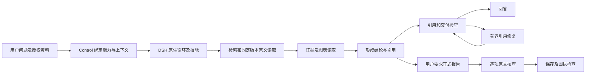

# 材料研发研究完整链路审查（2026-11-12）

结论：当前最该优化的是指导的实际送达、能力版本与核查协议的解耦、关键结论的事实核对，以及引用失败后的交付修复。继续加长技能正文不能补齐这些环节。

初次审查结合现有代码、检索设计文档和此前 24 次真实 A/B 的原生事件及任务快照检查。当时只修复能力版本分支回归；下文问题状态记录审查时情况，后续指令与交付整改见文末。未重新运行模型评测、未重启应用服务、未修改业务资料。此次没有重新验收上传解析、全库召回质量或生产负载；不能将静态审查当作这些环节已通过端到端验证。

## 链路与现有保障

| 环节 | 已有机制 | 审查判断 |
|---|---|---|
| 请求与范围 | 用户指定资料、权限范围、来源版本、会话授权 | 应保留，不能为补查绕过范围或擅自联网 |
| 能力绑定 | 能力包、指纹、按需原生技能 | 包内指导与共享回答规则存在送达断点，见问题 1 |
| 检索 | 多路召回、融合、重排、固定版本检索、降级说明 | 已有公共流水线；本次没有证据证明召回是主要退化原因 |
| 原文读取 | 目录、整节点分页、父块、表头、去重、refresh、无进展检测 | 已有较完整机制；版本升级误切分支已修，见问题 2 |
| 图表 | 先定位，再取得原图，再原生 read_image | 日志确认实际读图；仍发生误读，不能把“调用成功”算作识别正确 |
| 推理 | 技能指导、候选证据矩阵 | 候选解释不等于已证实事实，普通回答的事实核对不足，见问题 4 |
| 输出 | 合法引用、指定来源引用、文件哈希、真实业务回执 | 引用合法不等于支持结论；修复未用足已配置预算，见问题 3 |
| 执行与评测 | 原生日志、用量、持久账本、失败留存 | 保留；需修正能力声明及实验变量控制，见问题 5、6 |

## 1. P1：文献能力指导和共享回答规则未按设计送达

**证据。** `control/src/aird_agent/core/bindings.py` 的基类会按已选能力拼接指导，但 JSD 覆盖实现 `hosts/jsd/bindings.py:344` 仅返回 `CORE_INSTRUCTIONS`。因此修改 `LITERATURE_INSTRUCTIONS` 并提升文献能力指纹，不会使这段指导进入实际系统提示。原生插件使用绑定返回的 instructions，无法补回被裁掉的部分。

`capabilities/registry.py:23` 将 `ANSWER_INSTRUCTIONS` 直接设为 CORE；core 的 `answer_guidelines` 资源也存这个值。详细的 `capabilities/answer_guidelines.txt` 在文档中被描述为共享规则，但研究主路径没有读取该文件。现有资源指纹测试检查的是别名后的常量，Java 的资源测试检查打包一致性，都没有验证模型实际收到什么。

**日志交叉核对。** 增强组 M01-r1 的原生事件没有“材料研发的跨文献比较”“涉及过程总耗时”“先核对问题前提和用户的硬约束”；新技能的“以用户目标拆题”出现在实际 tool/result 中。两组复杂题均加载各自技能，所以不是技能完全未加载，而是能力入口与共享规则没有按设计生效。

**建议。** 明确唯一的指导来源：基础事实规则以精简共享正文送达，专业工作法仍由原生技能按需加载；不直接把所有能力全文常驻拼接。移除或接通无效配置，保证实际 instructions 的摘要参与现有绑定 etag。增加真实 JSD 绑定到原生 system/message 的契约测试，验证包含必要规则且没有重复注入。此项尚未修改。

## 2. P1：指导版本被误当成核查协议开关（已修源码）

上次增强将 literature 从 4 升到 5，但三个位置仍只识别 `version == "4"`：

- `capabilities/literature/handler.py` 的 evidence_read：v5 返回旧式候选，跳过精确 quote、表头补齐及该分支的分页/无进展处理。
- 同文件的 report_save：v5 跳过同一 title/text/matrix 的已通过核查要求，也不发送质量协议、证据矩阵及核查结果。
- `hosts/jsd/task_state.py` 的交付检查：v5 跳过当前矩阵对应已核查报告的检查。

这是上次版本升级引入的明确回归，不能解释为模型随机波动。已统一为 `quality.uses_source_review`：未标版本和 1–3 保持旧兼容行为，4 及之后版本继承原文核查协议。新增 16 项参数化测试，覆盖 4/5/6 的精确引用、未核查禁止写入、已核查保存载荷、旧核查不得完成，以及旧版本兼容。

这不等于已找到内容分下降的直接原因：增强组没有调用 evidence_read；本次普通问答也没有保存正式报告。该回归揭示了实验变量不干净和系统核查风险，不能硬归因到某个错误答案。

后续宜将指导版本、读取协议、报告质量协议显式分开，避免文案升级改变工具语义。本轮只完成兼容修复，未另改协议结构。

## 3. P1：引用修复链路实际只触发一次，说明文字会再次破坏交付

`enterprise-plugin/src/index.mjs:412` 用当前轮是否已有 citation-correction 消息阻止再次修复。服务端允许最多两次模型调用，但插件在第二次停止时直接完成，不会按剩余预算重新请求诊断。`src/citation-repair.mjs` 又没有明确要求只输出修正后的正文，模型会附加修复说明。

重新运行现有引用诊断，三个失败都能定位到修复说明里的坏句柄：原版 M03-r1 第 140 行、原版 M04-r2 第 1 行、增强 M03-r2 第 1 行。三者持久计数均为 `model_calls=1 / max_model_calls=2`。正文已修过，但说明文字再次复述了无效句柄。

**建议。** 要求只交付修正正文与必要资料缺口，诊断及修复历史留在账本，禁止在正文复述坏句柄；在同一 DSH 循环内按服务端持久计数和最新诊断使用剩余修复机会。最后一次仍只输出正文，保留原有读取范围及预算。不得通过忽略代码块引用、删除校验或无限重试掩盖问题。

增加原生停止钩子的契约测试，覆盖首次失败、第二次仍错但有预算、预算耗尽、没有错误时直接交付。界面应清楚区分“已有可复核草稿，但引用交付未通过”与“没有生成答案”。此项尚未修改，不能预先保证第二次一定成功。

## 4. P1：普通研究回答缺少关键结论与原文的对应核对

`hosts/jsd/bindings.py:636` 的输出检查主要验证引用合法及是否使用指定来源；完成状态明确标记为业务回执已查、并非科学核查。真正逐项事实核查位于 `LiteratureTools.report_check`，普通聊天不自动进入。用户没要求正式报告时，即使读了原文并给出合法引用，错误外推仍能交付。

本次例子包括：把贴合与等待时间之和当作全过程时间，漏掉另需数分钟的装夹；把一天后恢复约 70% 外推成永久损失 30%；对简单层厚问题主动补充错误总厚。它们分别需要过程条件、外推边界和计算核对，单纯确认引用 ID 存在无法发现。

**建议。** 简单取数保留直接回答，只核对本次数值、对象、单位和条件；复杂路线建议或关键工程结论复用现有原文核查能力，做少量关键断言的核对，不强迫保存报告或创建完整矩阵。按实际问题区分原文事实、计算、推断及建议，研究维度动态决定。确定性计算优先验证输入与公式；缺少原文条件时保留未知项，不能按零计。不得为核查再造代理执行循环。

还应约束无关扩写：完成用户问题后，新增内容必须有明确作用。不能用回答长度、读过多少页或模型自称“已自检”作为质量指标。此项是设计补强，尚未实现或评测收益。

## 5. P2：执行能力声明与配置可用性不一致

CORE 与原生插件均无条件声明命令在 Linux 隔离沙箱运行。运行上下文虽有 sandbox_enabled，但当前本地配置关闭沙箱时仍可诱发 bash 调用。服务端拒绝宿主执行回退的边界正确，应保留。

原版 M01-r1 在加载技能后调用一次 `pwd && ls`，原生日志返回超时，随后进入结果隔离且没有答案。增强 M03-r1 也出现多次 bash 调用和无意义探测。现有日志尚不足以把该次未知结果唯一归因于沙箱关闭：已知 `SANDBOX_UNAVAILABLE` 在业务服务中有明确拒绝分支，不能把所有 UNKNOWN 都当成这处分支遗漏。

**建议。** 绑定指导和原生工具可用性随真实配置变化；不可用时直接使用已有读取能力或说明本次计算限制。检查提交、输出轮询、取消和清理的状态衔接：确认未提交的拒绝不应升级成“已接受但结果未知”，真正可能已接受的执行仍须对账，不能自动重放。优化前补充拒绝、提交丢响应、取消与输出拉取组合的链路测试。此项尚未修改。

## 6. P2：评测与观测尚不能分离各项改动的作用

旧结果仍是当时两个实际版本的真实表现，评分和失败不能删除。但该对照不能再描述为完整增强方案或纯提示比较：共享规则未送达，pack 升级又意外改变工具协议。之前 120 项后端相关测试未覆盖新增版本的协议契约，因而漏掉了回归。

下一轮建议先验收真实系统提示、工具返回契约及引用停止钩子，再分别测试：只修链路、再加关键断言核对、最后调整研究指导。固定模型、资料、权限、预算和配置，冻结实际系统提示/技能摘要及协议清单；独立测试账号隔离记忆设置。使用随机交错组序、独立资料及评分者，保留失败草稿和成功交付两套分数。

延迟按检索、原文读取、模型生成、核查及修复拆分；已有阶段计时可复用，不用各并行调用累计耗时冒充墙钟时间。主模型缓存 Token 与辅助核查用量分别记录，没有账单就不推费用。

已有只读并行调度，本次 M02-r1 也实际成对提交目录、原文和读图调用，不能再把“增加并行能力”当作缺失功能。优先看实际重复读取和定向补查是否有收益，再决定优化。原件中 −11°C 被回答写成 −77°C 的问题已视觉核对，但尚未定位是解析、投影还是模型识别错误，应逐层对照输入，而非直接归咎 OCR 或重做检索。

## 实施顺序与验证状态

1. 先接通并验收指导送达、保持能力协议稳定，修复有界引用交付及沙箱状态矛盾。
2. 再给复杂材料判断增加关键断言核对；简单查询保持短路径，不固定研究维度。
3. 最后做受控对照，分别报告事实准确、条件保留、问题覆盖、交付成功、耗时及实际用量。

本轮已完成：版本分支修复及新增 16 项测试；连同证据、报告与文件能力测试共 **136 项通过**，改动的四个 Python 文件 Ruff 通过。测试验证协议行为，不能代替新一轮真实模型质量评测。没有重载当前服务，没有新 A/B 结果；其余建议尚未落地。原始 24 次测量、评分、运行记录和当时配置快照保持不变。

## 后续实施：指令送达与引用交付修复

用户随后要求先修这两个环节，现已完成以下源码修改：

- `registry.py` 从包内实际读取 `answer_guidelines.txt`，将原有完整规则纳入 core 指导和能力指纹；不再用 CORE 常量冒充共享规则。`JsdBindings.instructions_for` 传入基础规则及所选能力指导，基础规则只出现一次；复杂研究工作法继续使用已有原生技能。旧式未标能力的文献任务保留兼容指导。
- 运行指导根据实际 sandbox_enabled 声明命令沙箱是否可用；移除插件额外追加的无条件可用声明，文件能力说明改为启用时适用。本次只修正指令，没有改变沙箱提交、取消或未知结果的对账机制。
- 引用失败后的停止钩子读取服务端持久计数；有剩余请求时可以继续修复，同一 Run、轮次和已用请求数只排入一次修复消息。预算耗尽时仍走失败交付，不新增模型循环或放宽引用校验。
- 每次请求修复都重新诊断最新答复，只更新诊断，保持原有模型/工具计数、上限和允许来源。服务重建或重复请求不能重置额度。
- 修复提示展示剩余请求及可用补读次数，要求只输出修正后的完整正文和必要缺口，不附加修复说明，也不在正文、引号或代码中复述坏句柄。最后一次请求只输出答案。

验证覆盖实际 JSD 指令、共享文件内容、能力选择、绑定增量/etag、沙箱配置变化、原生首次及后续提示、重复停止去重、一次和两次修复预算、最新诊断、恢复后计数不重置、最终成功及最终仍失败、截断保留原流程，以及文件交付回归。相关后端 **192 项通过**，使用临时独立 `jsd_aird_agents_chain_repair_test` 数据库；Node 定向回归 **17 项通过**；改动 Python 的 Ruff 及修改的插件入口语法检查通过。临时 PostgreSQL 在检查完成后停止，不使用业务库。

扩大验证时还运行了 `test_task_entry.py`：其中两项同步派发断言失败；在忽略目录中复制源码并将所有修改的后端源文件恢复到 Git HEAD 后，用同一个隔离测试库重跑，复现相同两项失败。当前入口调用 admission 排队，而测试断言返回前已经完成 create/prompt；本轮未修改该入口或将失败测试改为通过。该既有测试问题不计入上述 192 项通过。

该阶段应用服务尚未重载。新增指令会改变能力指纹，须由新请求正常绑定；不能绕过旧 Run 的版本校验来热替换。随后已完成下面记录的服务重启与真实模型检查，关键断言的事实核对仍是后续工作。

## 重启后实测：Qwen 3.7 Flash

2026-11-12 按用户要求重启 Control 与 DSH Gateway，启动配置中启用的 Docker 命令沙箱。部署主模型与当前管理员原生持久默认模型覆盖均改为 `qwen3.7-flash-2026-07-15`。最初只改部署默认时，工作台仍使用持久覆盖中的 DeepSeek；同步个人覆盖后，Qwen 请求又被继承的 256000 输出上限拒绝。接口明确允许 `[1, 131072]`，故补充 `JSD_AIRD_DSH_MAX_OUTPUT_TOKENS=131072` 并重载。修正后连通检查成功，全部正式请求头和主模型收据均确认 Qwen、high 推理及该输出上限。

复用原六题各两轮，固定授权资料、禁联网、新会话，共12次，11次成功交付、1次引用失败。12次原生 system/message 均包含共享回答规则、文献能力入口指导和当前沙箱状态；复杂题6次中4次实际加载研究技能，M02-r1、M03-r2未加载，说明送达不等于模型遵守。

4次自然引用修复中3次交付成功。M03-r2原生日志确实排入已用次数0、1的两次修复提示，最终服务端模型计数2/2，未重置额度或额外重试；正文仍有8处未知证据ID，最终保持FAILED。第二次机会已经生效，但不能保证模型修复成功。M06-r2仍附加修复说明，未复述坏句柄，因此通过校验；指令遵守仍有波动。

内容开发评阅均分5.67/10，交付分5.17/10，平均任务耗时117.9秒、中位数91.2秒。仍有30秒定性接合被当作完整力学恢复、未验证被说成机理不可能、浓度相态混淆，以及简单题漏Ag150nm。M01-r1原生工具结果已送达装夹限制段落，仍发生误读。普通回答没有自动逐项科学断言核查，不能将引用交付通过当成内容核查通过。

模型与链路同时改变，本次不是只修链路的因果A/B。旧增强版DeepSeek的7.00/10与本轮分数仅供定位，不能证明链路导致退化或模型普遍优劣。题集是已有开发资料，由实现代理对照原PDF核对，非独立盲评。末尾采集会话被替换后，仅GET原任务和事件补收，未重放；原中断记录保留，记忆读取/自动采集最终恢复true/true。末次网关和沙箱健康检查200且可用，沙箱ready=4、无宿主执行回退；后台自动化身份换票仍有401日志，该后台链路未在本轮验收。

完整本地记录：`.runtime/materials-research-qwen37-20261112/validated-2/report.md`，包含12份原答、逐项评分、原生事件、配置和源文件快照、用量及服务检查。前两次连通调试记录与旧24次对照保持独立。没有账单，费用未知。下一步应固定当前模型和预算，先补关键断言与原文条件核对、复杂技能遵守及简单取数完整性，再进行受控质量对照。
