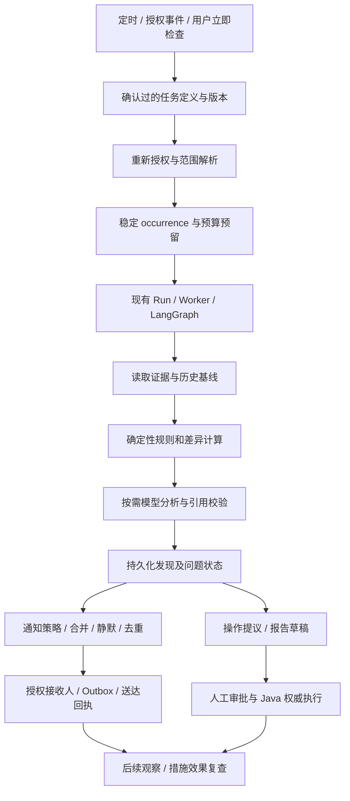

# 定时任务、主动巡检与长期跟进蓝图

> 2026-10-22 首批代码已实现：每日健康巡检、到期与停滞跟进、里程碑预检查、周报草稿、审批提醒。
> 当前运行说明、已支持字段和真实边界以 [MONITORING.md](MONITORING.md) 为准。
> 下文保留完整路线图，其中未交付的认领、升级、外部通知、自然语言长期任务等仍属后续。


更新日期：2026-10-22。本文件是新增能力设计和后续验收要求，不代表全部功能已经实现。
当前源码基线见 `app/platform/scheduler.py`、`app/verticals/project/manifest.yaml` 和 [验收记录](TEST_RESULTS.md)。

主动能力作为共享平台的核心模块，统一服务 project、quality、rnd、production 等 Vertical Packs。
Scheduler 决定何时投递，LangGraph 编排检查和分析，业务 Gateway 获取授权数据，通知组件按明确策略送达。
不在各 FastAPI 进程或各业务模块中再建立定时器，不改变 Java 的业务数据、权限和正式写入权威。
继续采用原生 Python、独立 PostgreSQL 与独立 Worker，暂不使用 Docker。

## 1. 已有基础与新增范围

| 能力 | 当前状态 | 本次补充的后续要求 |
|---|---|---|
| 统一调度 | 已实现固定间隔、Cron、一次性日期、显式排除日期、已认证 HTTP 事件触发 | 完整节假日/调休、通用条件触发 |
| 运行与恢复 | 已实现 Run/occurrence、跨进程去重、独立 Worker、Checkpoint、预算、规则版本、观察历史与检查覆盖率 | 更丰富的趋势和复查工作流 |
| 生命周期 | 已实现创建、查询、暂停、恢复、取消 | 配置修改、独立立即运行、软删除及自然语言草稿确认 |
| 项目巡检 | 已实现首批五类规则报告、周初基线与证据 | 关键路径、计划漂移、复杂跨模块场景 |
| 主动跟进 | 已实现 Finding、明确恢复/复发、去重、静默、Outbox、模拟站内投递及已读 | 认领、升级、负责人汇总、外部渠道 |
| 时区与成本 | 已实现 IANA 时区、DST 规则、排除日期、静默时段、调用数/活动时长/输出预算 | 完整业务日历及可核验金额预算 |
| 真实业务和通知 | 当前为 Mock 与模拟站内收件箱；未启用外部消息发送 | Java 授权和来源验证通过后再接真实业务；外部渠道另行接入 |


首次到期时间不能代替一次性任务；每隔 86400 秒不能代替每个工作日 08:30。
下文的扩展设计不等于全部已经交付。首批已实现 Cron/日期触发、规则、历史基线和模拟站内收件箱；不自动启用长期订阅，不发送外部消息，具体字段见 MONITORING.md。

## 2. 场景目录

优先级表示工程顺序。所有阈值、频率、接收人和自动行为都必须可配置，下面的天数和时间只是示例。

### 项目管理首批场景

| ID | 场景 | 触发建议 | 检查内容与交付 | 优先级 |
|---|---|---|---|---|
| PM-01 | 项目健康巡检 | 工作日 08:30；项目关键变更 | 项目/阶段/任务偏差、逾期与风险，附证据、覆盖范围和建议 | 首批 |
| PM-02 | 到期与逾期跟进 | 每个工作日；到期前 3/1 天 | 临期清单、逾期天数、责任人及阻塞信息，按负责人合并提醒 | 首批 |
| PM-03 | 停滞和阻塞任务 | 每日；阻塞状态变化 | 距上次有效进展的时间、阻塞持续时间、缺失原因及待确认项 | 首批 |
| PM-04 | 里程碑预检查 | 到期前 7/3 天；前置条件变化 | 前置任务、交付物、测试与验收条件，生成缺口清单 | 首批 |
| PM-05 | 日报、周报、月报草稿 | 每日摘要、每周五、月末 | 已完成/新增/延期/风险及与历史快照的变化，生成有引用草稿 | 首批，先做周报 |
| PM-06 | 审批待办跟进 | 每日；等待超时；临近失效 | 待审批清单、提醒；过期停止原动作，要求重新预览与审批 | 首批 |
| PM-07 | 关键路径与缓冲预警 | 每日；依赖/工期变化 | 基于真实依赖、工期和日历计算关键路径/浮时，解释里程碑影响 | 第二批 |
| PM-08 | 计划基线漂移和反复延期 | 每周；计划日期变更 | 比较已批准基线、当前计划及日期变更历史，识别连续顺延 | 第二批 |
| PM-09 | 人员与设备资源冲突 | 排期变更；每日 | 分配工时、可用日历、设备预约的重叠；提出调整方案 | 第二批 |
| PM-10 | 会议决议和承诺跟进 | 纪要保存；承诺到期 | 提取责任人/期限/决议，生成任务草稿；跟踪尚未落实的承诺 | 第二批 |
| PM-11 | 风险升级与整改效果复查 | 风险升级；措施后 3/7 天 | 检查补救措施是否实际改善指标，保留根因假设及待验证项 | 第二批 |
| PM-12 | 需求/设计变更影响 | 新版本或变更申请 | 比较版本，追踪项目、任务、实验、交付物的影响，提出重排建议 | 第二批 |
| PM-13 | 外部交付与采购依赖 | 每日；供应商承诺变更 | 样品、物料、外协测试等交付风险；通过授权工具读取供应链数据 | 后续跨模块 |
| PM-14 | 预算与工作量偏差 | 每周；授权成本数据更新 | 已批准预算/工作量与实际偏差；只有工时数据时不虚构金额 | 后续跨模块 |
| PM-15 | 负责人变化和交接完整性 | 已授权人员/责任变更事件 | 识别无人负责、交接缺失、未完成承诺；只提议重新分配 | 第二批 |
| PM-16 | 项目收尾与归档就绪 | 进入验收/完成阶段 | 未关闭任务、交付物、报告、验收和归档完整性，生成收尾草稿 | 第二批 |

### 研发、数据与其他垂直应用

| ID | 场景 | 触发建议 | 检查内容与交付 | 模块与阶段 |
|---|---|---|---|---|
| RD-01 | 实验和测试进度 | 每日；实验状态变化 | 已开始未记录、测试逾期、结果未录入，标记数据不完整 | rnd，P3 |
| RD-02 | 新实验结果差异分析 | 导入完成/结果发布 | 比较轮次、配方、工艺、测试条件及性能，区分可比结果和混杂因素 | rnd，P3 |
| RD-03 | 实验结果触发优化 | 验证通过的新结果 | 调用已注册预测/优化工具，形成下一轮候选方案草稿，保留模型版本及适用范围 | rnd，P3 |
| RD-04 | 设备维护、校准与测试就绪 | 预约前；有效期临近 | 缺少就绪证据或校准状态时提示核实，不自动替代质量/设备负责人判定 | rnd/production，后续 |
| DQ-01 | 导入、审核与发布异常 | 失败事件；每日汇总 | 失败、待审核、质量阻断、关联缺失和计算有效性；提供定位证据 | 各模块规则，P3 |
| DQ-02 | 知识与证据有效性 | 文档撤回/版本发布；每周 | 来源失效、过期引用、已发布报告可能受影响，提醒重新核对 | knowledge 连接器，P3 |
| DQ-03 | RAG 与 Embedding 回归 | 模型/索引升级；每周 | 用获授权黄金集比较召回和答案依据，单列检索失败与语义退化 | 平台评测，P3 |
| DQ-04 | AI 检索/训练资格巡检 | 资格/发布状态变化 | 检查现有治理状态；可读取或检索不等于允许训练，缺少明确资格时不使用 | 复用现有治理，P3 |
| QA-01 | 质量整改与复发跟踪 | 异常发布；整改到期 | 未关闭整改、验证证据和同类复发，生成问题复查建议 | quality，后续真实适配 |
| PR-01 | 生产与交付风险联动 | 异常停机/排产变化；每日 | 分析对相关项目及交期的影响，按各模块权限分别取证 | production/project，P3/P4 |
| CX-01 | 客户承诺和需求响应 | 承诺到期；需求版本变化 | 跟踪样品、答复、验收承诺及依赖，生成回复草稿，不自动对外承诺 | 客户模块，后续 |
| AI-01 | AI 平台健康与成本巡检 | 每日；连续错误 | 模型/工具失败、队列积压、恢复失败、检索异常、调用预算偏差 | 平台级受限运维任务 |

### 必须同时处理的两类“异常”

业务风险和巡检自身失败必须分开。Java 超时、分页未完成、数据过旧、未授权资源跳过或证据不足时，
结果标记为不完整/未知，保留已检查范围及未检查原因，不能输出“全部正常”或“已完整检查”。
即使没有发现新风险，也应在运行记录保留覆盖率和数据时间；是否发“无异常日报”由用户订阅策略决定。

## 3. 主动检查的标准执行链路



延期天数、截止日期、规则阈值、版本比较和依赖计算由确定性代码完成；模型用于解释、根因假设和方案草稿。
规则明确自然日/工作日、日期型截止时间的业务时区口径，并区分未完成任务逾期、已完成任务历史延期和已取消任务。
没有工期/日历/依赖数据时只报告缺口，不声称已经计算关键路径。项目完成率使用已定义权重/基线，不能简单平均任务百分比。
“连续三天未进展”需要足够观察历史或权威进展记录，不能只看一次快照，也不能把无关字段修改当成有效进展。

每次保存 `observed_at`、业务数据时间、检查窗口、证据版本、规则版本、基线引用及覆盖情况。
历史比较采用授权的小型快照/Artifact 或业务系统版本查询，避免复制整套业务数据库。

## 4. 任务配置、日历与恢复

下列为目标契约；实施时优先扩展现有 Schedule，不建立另一套任务系统。

| 配置组 | 最少内容 |
|---|---|
| 定义与版本 | 名称、Pack/工作流/规则/Skill 版本、配置摘要、草稿/确认/活动版本 |
| 可信主体 | 组织、创建者、实际操作者或受限服务主体、授权引用和失效策略；来自服务端 |
| 检查范围 | 明确项目 ID 或审核过的范围选择器、资源数上限、当前授权交集 |
| 触发 | interval / cron / date / event / condition，生效与结束时间、触发版本 |
| 日历 | IANA 时区、企业工作日历及版本、节假日/调休、DST 缺失/重复时间处理 |
| 检查规则 | 注册规则 ID、版本、阈值、窗口、连续次数、有效进展口径、严重程度 |
| 通知策略 | 明确渠道、接收人规则、内容模板/数据最小化、即时/摘要、静默时间及冷却 |
| 去重与升级 | 问题指纹、抑制窗口、升级阈值、恢复通知和未读提醒次数 |
| 运行控制 | 同任务/同资源并发、最大资源量、最长活动时间、模型/工具/token 上限、到期时间 |
| 费用 | 金额币种/价格版本/usage 来源、预留与核销；未知费用单独标识，不按零计 |
| 故障与补跑 | 有限重试/退避、连续失败暂停阈值、skip / coalesce / bounded catch-up |
| 审计与保留 | 创建/确认/修改/暂停/删除、运行、发现、投递、回执、动作的关联与保留期 |

“我负责的项目”应映射为已确认的范围选择器，在每次运行时与 Java 当前授权取交集，限制最大项目数量。
它不是缓存一次全公司项目清单或取得长期超级权限。当前 API 仅支持明确单资源范围，选择器属于后续能力。
未实现的模块、规则、权限映射或渠道不能被模型临时创建；应提示能力缺口。

工作日采用企业可维护的日历，不能只用周一到周五替代节假日/调休。保存下一次 UTC 到期时间，并展示用户时区。
静默时段默认延迟普通提醒；严重告警是否突破静默必须由明确策略授权，不能由模型临时决定。
日报适合合并补跑，临期提醒超过有效时间应跳过，审计类检查可有限补跑；不得无限积压。

条件触发必须由受限、确定性的条件求值器基于授权数据或可信事件执行，禁止存储任意 Python/SQL/eval 表达式。
事件包含唯一 ID、源、类型、资源版本和发生时间；验证来源及组织归属，处理重复、乱序、延迟和失效事件。
应设置防抖与循环抑制，避免“AI 修改 → 变更事件 → 同一修改提议”的自激循环。

## 5. Finding、告警降噪与自动跟进

定时任务每次运行产生 Observation；跨轮次的同一问题维护为 Finding，不能把每次运行都当成新告警。
建议问题状态为 OPEN → ACKNOWLEDGED → IN_PROGRESS → RESOLVED；复发开启新 episode，保留历史。
可设置有期限的 SUPPRESSED。认领、处理和关闭必须记录真实操作者及依据；AI 不能仅凭建议已生成就标记问题解决。

指纹至少包含组织、Pack、监控对象、授权视图/范围、规则 ID/版本、资源 ID 和稳定条件编码。
指纹不能仅用模型描述、Run ID 或当前证据版本；描述改写和一次快照更新不应重复提醒。
跨 Schedule 合并也必须保持授权视图隔离，不能让低权限用户推断或接收高权限运行的发现和证据。

通知建议规则：

- 首次达到阈值通知；同一问题未升级时冷却或纳入日报，避免每轮重复轰炸。
- 严重程度升级、影响范围显著增加或措施到期未改善时，根据已确认策略再次通知。
- 恢复通知、再次提醒、升级负责人和最大提醒次数分别配置；不要自动扩大接收人范围。
- 接收人每次送达前重新核验身份、组织及证据访问权；任务创建者可访问不代表所有负责人都可接收。
- 邮件/企业消息默认发送最少摘要与经访问控制的链接，敏感证据不得直接复制到未经核验的渠道或群组。
- 通知采用 Outbox、投递幂等键及回执；外部渠道不支持幂等/查询时，网络结果未知不能宣称恰好送达一次或盲目重发。

自动跟进跟踪“发现 → 已提醒 → 谁处理 → 哪个动作/任务 → 验证结果 → 是否复发”，并设置截止日期和终止条件。
反馈可用于用户调整规则和阈值；不允许模型自行学习出新的授权或静默放宽阈值以消除告警。

## 6. 用户在对话中安排长期任务

目标链路：自然语言请求 → 结构化草稿 → 白名单/授权/日历/预算校验 → 展示范围、规则和最近几次执行时间 →
用户确认具体配置摘要 → 创建活动版本 → 后续运行可追踪、暂停、恢复、修改、立即执行或软删除。

确认长期任务只授权已展示的检查及通知策略，不是批准未来所有业务写入。
每一项正式业务写操作仍需新的精确 Action 预览、审批、版本校验与幂等执行。
时区、执行范围、触发条件、通知对象、渠道、自动行为或预算实质变化时，原配置确认失效，需要重新展示并确认。
不明确的“每天”“负责的项目”“最近没有进展”必须澄清时区、范围及规则口径，不能后台猜测。

示例：“每个工作日 08:30 检查我负责项目，逾期和连续三个工作日无有效进展时提醒我，周五给周报草稿。”
可生成一个长期监控定义，关联健康检查和周报两个已注册计划，共享符合授权的观察历史及告警去重。
不能把两个不同频率的意图丢掉一个，也不应为它另建 Agent 服务。

目标草稿示例（不是当前 `/schedules` API 请求体，也不是 Skill 文件标准）：

```yaml
name: 我的项目进度跟进
pack_id: project
workflow_id: project-health-check
scope_selector: {kind: owned_by_current_subject, max_resources: 20}
trigger:
  kind: calendar
  timezone: Asia/Shanghai
  local_time: "08:30"
  calendar_ref: organization-work-calendar
rules:
  - {id: task-overdue, threshold_days: 1}
  - {id: task-stalled, threshold_business_days: 3}
notification:
  recipients: [current_subject]
  channel: in_app
  mode: on_new_or_escalated
  quiet_hours: {start: "20:00", end: "08:00"}
  minimum_repeat_interval_hours: 24
report: {kind: weekly_draft, weekday: fri, local_time: "17:00"}
business_writes: require_per_action_approval
confirmation: required
```

真正保存时由服务端补充主体、组织、权限引用、配置/规则/日历版本和确认记录；模型不能填写这些字段取得身份。
归档/软删除保留历史 Run、证据、投递回执和 Action 审计；停止未来触发，并明确当前 Run 是继续还是取消。

## 7. 自动行为和业务写入边界

| 行为 | 约束 |
|---|---|
| 授权查询、确定性检查、差异分析、报告草稿 | 可在确认的任务范围和预算内自动运行，结果必须带证据和数据时间 |
| 符合订阅策略的站内提醒/外部通知 | 需明确的通知授权、注册渠道、接收人授权、去重及回执；不能由模型自定接收人 |
| 任务创建、负责人/日期/状态修改、正式发布或归档 | 统一 Action：权威预览 → 精确人工审批 → 重新授权/版本/幂等 → 写后验证 |
| 创建/启用或实质修改长期任务 | 用户确认具体配置；此确认与业务 Action 审批分别留痕 |
| 权限失效、范围歧义、关键数据缺失、证据不足、版本冲突、审批过期 | 停止相应动作并明确原因；按授权策略要求澄清、重新授权或新审批，不继续猜测 |

通知不是自动写业务数据的豁免通道；若“提醒”会创建正式业务记录，也必须进入 Action 链路。
自动通知属于必须单独实现并明确授权的策略，不能把任意写工具标成“通知”而免批。
Mock 风险、报告和通知回执保持 `simulated=true`，使用假通知渠道，不把测试风险发送给真实人员。
长期任务不存长期用户 Cookie/Session Token；保存受限主体和授权引用，运行时通过受控方式获得短期委托。
用户离职、任务转交、权限/授权撤销时暂停并要求重新确认主体，不能自动切换为管理员。
当前没有真实 Java 委托适配，以上先在隔离 Mock 环境验证；生产批量巡检仍需 Java 权限验收。

## 8. 技术选型与最小存储增量

继续复用已运行的 PostgreSQL Scheduler/occurrence/Run 账本和 Worker。先抽出 `TriggerProvider`、
规则求值、基线访问和通知 Gateway 的明确接口；成熟库负责日历触发计算，JSD 负责授权、版本、规则、投递与审计。
不因为增加 Cron 就同时维护两份任务真相，也不让第三方调度器直接执行不受治理的模型或业务工具。

APScheduler 可作为后续触发适配候选，但必须区分版本：3.x 的 JobStore 不允许多个 Scheduler 共享；
master/4.x 文档中的多 Scheduler 协调要求共享事件 Broker，不能照搬到 3.x。
这次没有安装 APScheduler，也没有把 master 文档视为已锁定可用的运行依赖。
先验证锁定版本、触发计算、DST、升级和进程协调，再决定仅复用 Trigger 还是完整适配。
来源：[APScheduler 3.x 用户指南](https://apscheduler.readthedocs.io/en/3.x/userguide.html)、
[多 Scheduler 协调](https://apscheduler.readthedocs.io/en/master/userguide.html#using-multiple-schedulers)。

Cron 解析要记录方言及版本；APScheduler 3.x 与传统 crontab 的数字星期口径不同，目标配置优先使用星期名称，
并在确认页展示下一批实际执行时间，升级时重验。
来源：[CronTrigger 官方文档](https://apscheduler.readthedocs.io/en/3.x/modules/triggers/cron.html)。

当前无需引入 Celery。若以后改用 Beat，仍须保证同一计划只有一个有效调度者，执行重叠还需并发控制，
不能认为更换组件就自动消除重复。来源：[Celery 周期任务说明](https://docs.celeryq.dev/en/stable/userguide/periodic-tasks.html)。

持久化优先复用现有结构：Schedule 扩展定义/确认/版本/日历/规则/通知策略；occurrence/Run/Step/事件仍用现有表。
后续确有需要才增加监控观察/基线引用、Finding 状态及通知 Outbox/回执，不建立第二套会话、IAM、审批或业务任务表。
具体 Schema 与迁移需在实现前对照现有 Java 消息、订阅、审计及业务问题结构核对，本次不发布未实现的 SQL 迁移。

## 9. 实施顺序与验收

| 阶段 | 交付范围 | 准入与验收 |
|---|---|---|
| P1：核心增强 | 扩展触发/规则/通知契约，定义版本与确认流程；Mock 历史观察、Finding、报告草稿和投递账本 | 全程无需 Java；覆盖日历、去重、重启、撤权、确认摘要与假通知渠道 |
| P2：项目主动管理 | 优先 PM-01～PM-06；每日巡检、到期/停滞、里程碑预检、周报草稿及审批提醒 | 先完成完整 Mock 体验，真实业务数据/提醒需 Java 和通知授权验收 |
| P3：研发与治理 | 实验/测试、数据质量、知识有效性、RAG 回归、实验事件分析及其他模块规则 | 复用业务工具与现有知识库治理，各 Pack 独立验收与预算 |
| P4：复杂长期任务 | 多项目依赖、长期趋势、资源/生产/客户协同及受授权后续行动规划 | 跨模块分别授权，长任务可停止、恢复、对账；写操作不降低审批要求 |

必须新增的自动化验收：

1. Cron/间隔/一次性/事件/条件的时区与日历语义；节假日、调休、DST、月末和到期终止。
   时间相关用例注入可控时钟与版本化日历，避免依赖测试运行当天。
2. 两个进程同时到期、同资源重叠计划、重启补跑/跳过/合并，以及事件重复/乱序/防循环。
3. 数据分页或一部分工具失败时报告覆盖缺口；无历史基线不声称连续停滞或同比/环比趋势。
4. 同一问题跨运行去重，按授权视图隔离；升级、恢复、复发、冷却、静默及摘要合并可复现。
5. 接收人越权、离职、组织变化、订阅取消后不投递；未知送达结果先对账，失败不重复轰炸。
6. 长期任务范围/频率/规则/通知变更后原确认无效；立即执行、暂停、恢复、软删除和配置并发版本冲突。
7. 定时写提议、审批提醒或“每天检查待审批动作”均不能自动批准、复用过期审批或重复写入。
8. 所有产出可追溯定义、规则、日历、模型、工具、证据、Run、Finding、通知及 Action 版本。
9. 模型/工具/资源数/时间及金额预算耗尽时停止或执行已声明的无模型降级；未配置金额核算不能标记已完成。
10. 既有 project/quality 扩展、审批/幂等、恢复和引用校验回归继续通过；新增能力未经测试不标为完成。

新增指标应包含计划到期延迟、队列等待、检查覆盖率、业务风险数、巡检失败数、告警去重率、送达延迟、
误报/漏报评测、预算消耗和问题解决时间；模型正常返回不等于业务风险检查成功。
